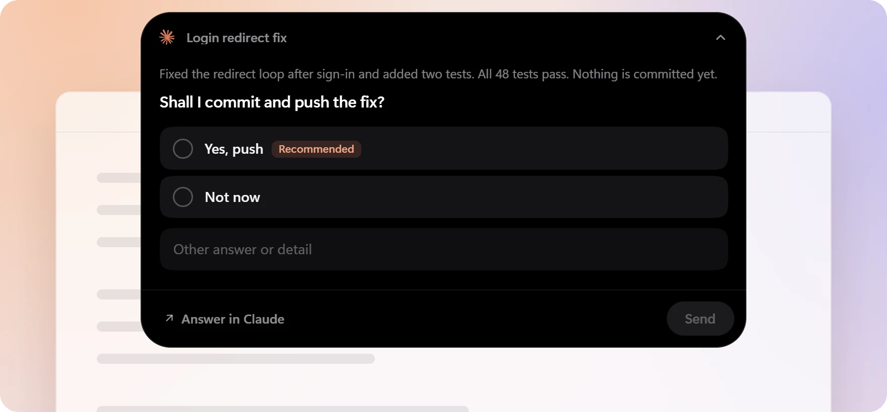
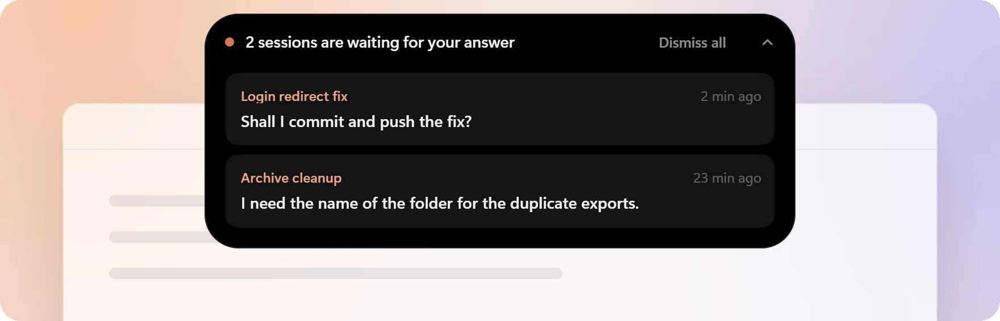
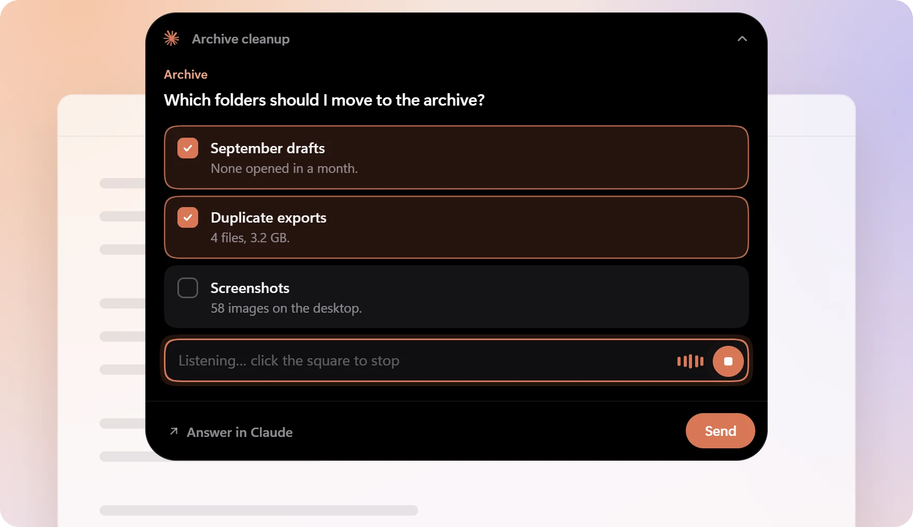

# Moonky Island

A Claude Code plugin for Windows. When Claude asks you a question with the AskUserQuestion tool, the
question shows up at the top of your screen, above every other app, and you answer with one click
without going back to Claude. A small pill also tells you when a session has finished its turn and is
waiting for your answer.

[Version française](README.fr.md)


## What it does

- **The island.** Questions asked with AskUserQuestion appear at the top of the screen without taking
  the keyboard. Pick an option, type your own answer, or click "Answer in Claude" to answer in the
  chat as usual. After 9 minutes without an answer, the question goes back to the chat and the pill
  takes over.
- **End-of-turn questions too.** In the Claude desktop app, when Claude ends its turn on a question
  with reply buttons ("Shall I push the commit?" with "Yes" and "Not now"), the question shows in the
  island as well, with the turn summary above it. Your answer goes back to Claude, which carries on.
  The app's action buttons, such as Commit or Create PR, stay in the app.

  

- **The pill.** When a session of the Claude desktop app ends its turn on a question, a pill shows the
  session title and what it is waiting for. One click opens the chat. It stays quiet when that session
  is already in front of you.

  

- **A reminder at session start.** Each session is told to ask your decisions with AskUserQuestion, in
  2 to 4 options, its recommendation first. Open questions (a name, an amount, a text) stay in the chat.
- **Dictation, optional.** A microphone button in the island, transcribed on your PC by Whisper.

  

If anything is missing or fails, the plugin steps aside and Claude asks its questions in the chat, as
it would without it.

## Requirements

- Windows 11 (Windows 10 has not been tried).
- Python 3.12 64-bit from [python.org](https://www.python.org/downloads/windows/), with the
  "py launcher" option checked (it is by default). Not the Microsoft Store version. It can live next
  to another Python version. In PowerShell, `py -3.12-64 --version` must answer `Python 3.12.x`.
- WebView2, already there on Windows 11. Otherwise install the Evergreen Bootstrapper from
  [Microsoft](https://developer.microsoft.com/microsoft-edge/webview2/).
- Claude Code. The island works wherever Claude Code runs hooks; the pill needs the Claude desktop app
  (Code tab). Written and tested with Claude Code 2.1.296 and 2.1.317.

## Install

1. Add the catalog and install the plugin for your whole user account:

   ```powershell
   claude plugin marketplace add moonky-studio/moonky-island
   claude plugin install moonky-island@moonky-island --scope user
   ```

2. Finish the setup on this PC (about 10 seconds, 7 MB to download). Either open a new session and ask
   Claude to "finish the Moonky Island setup" (the start reminder gives it the command), or run this in
   PowerShell:

   ```powershell
   $island = Join-Path ((Get-Content "$env:USERPROFILE\.claude\plugins\installed_plugins.json" -Raw -Encoding UTF8 | ConvertFrom-Json).plugins.'moonky-island@moonky-island' | Sort-Object lastUpdated | Select-Object -Last 1).installPath 'installer.py'
   py -3.12-64 $island
   ```

   The installer checks Python and WebView2, installs pywebview and pythonnet in
   `%LOCALAPPDATA%\moonky-ilot`, creates the settings file and ends with a summary. Running it again
   is safe: what is already in place is kept.
3. Open a new session. Sessions that were already open do not have the plugin's hooks.
4. To see the island without waiting for a real question, run the demo the installer prints at the end
   (`ilot\ilot.py --demo`, or `--open` to start on the questions). Nothing is sent to Claude.

`py -3.12-64 $island --check` tells you at any time what is in place and what is missing, without
changing anything.

## Settings

In `%LOCALAPPDATA%\moonky-ilot\reglages.json`, read again for each question, so no restart is needed.
Setting names are in French.

| Setting | Values | Default |
|---|---|---|
| `son` (sound) | `"marimba"`, `"glass"`, `"drop"`, `"windows"` (the Windows sound) or `"none"` | `"marimba"` |
| `langue` (interface language) | `"auto"` (follows Windows: French if Windows is in French, English otherwise), `"fr"` or `"en"` | `"auto"` |
| `dictee` (dictation) | `true` to show the microphone in the island (see below) | `false` |
| `dictee_langue` (spoken language) | `"auto"`, or a language code such as `"en"`, `"fr"`, `"de"`. With `"auto"`, French when the interface is in French, otherwise Whisper detects the language | `"auto"` |
| `pastille` (pill) | `true`, `false` (no pill) or `"observation"` (nothing shows, the log notes what would have) | `true` |
| `pastille_plein_ecran` | `true`: the pill also shows during full screen or a presentation | `false` |
| `questions_fin_de_tour` (end-of-turn questions) | `false`: questions from the end-of-turn summary stay in the app. Desktop app only | `true` |
| `whisper_python`, `whisper_modele` | paths to a Whisper you already installed elsewhere; empty, the island uses the one from `--whisper` | empty |

The data folder keeps the plugin's former name, `moonky-ilot`.

## Dictation

`py -3.12-64 $island --whisper` installs faster-whisper and the model
[mobiuslabsgmbh/faster-whisper-large-v3-turbo](https://huggingface.co/mobiuslabsgmbh/faster-whisper-large-v3-turbo)
in the data folder, then turns dictation on: about 1.8 GB to download, 2 GB on disk, 5 to 20 minutes.
With an NVIDIA card, CUDA 12 and cuDNN 9, transcription runs on the graphics card; otherwise on the
processor, slower. Audio never leaves your PC.

The microphone stays hidden until dictation is on and Whisper and its model are in place.

## What the hooks do

| Hook | Script | What it does |
|---|---|---|
| SessionStart | `ilot/rappel.py` | Adds the reminder to the session context. If the island cannot show yet, tells Claude the setup command instead. |
| PreToolUse on AskUserQuestion | `ilot/ilot.py` | Shows the questions and sends your answers back as the tool's answers. "Answer in Claude" or the 9-minute limit let the question go on to the chat. |
| PreToolUse on `mcp__ccd_turn__wrap_up` | `ilot/ilot.py` | When the desktop app's end-of-turn summary asks a question with reply buttons only, shows it in the island. Once you answer, the summary is refused with your answer as the reason: Claude goes on from there, then sends its summary again without the question. "Answer in Claude", the 9-minute limit or the same question coming back let the summary through unchanged. |
| Stop | `ilot/attente.py` | Starts a detached watcher and returns at once, with no output. The watcher shows the pill if the session ended its turn waiting for you. |

## Turn off, update, uninstall

- Turn off without uninstalling: `py -3.12-64 $island --off`. Questions stay in the chat, with no
  island or pill. `--on` turns everything back on. The switch is the file
  `%LOCALAPPDATA%\moonky-ilot\coupe`: deleting it does the same as `--on`.
  `claude plugin disable moonky-island@moonky-island` (then `enable`) also works, for sessions opened
  after the command.
- Update: Claude Code does not update third-party catalogs by default. Run
  `claude plugin marketplace update moonky-island`, then
  `claude plugin update moonky-island@moonky-island`, run the installer again (it downloads libraries
  again only if their versions changed) and open a new session.
- Uninstall: `claude plugin uninstall moonky-island@moonky-island`, then delete
  `%LOCALAPPDATA%\moonky-ilot`.

## What stays on your PC

Nothing is sent over the Internet. Only the installer downloads: libraries from PyPI and, with
`--whisper`, the model from Hugging Face.

Everything lives in `%LOCALAPPDATA%\moonky-ilot`, never in the plugin folder, which is replaced on each
update: libraries, settings, the off switch, Whisper if installed, for each session a fingerprint of
the last end-of-turn question you answered in the island (never its text), and logs deleted after
7 days. Logs
record session titles and the island's steps; in `"observation"` mode, also the start of what the pill
would have shown. Your answers are not logged, and dictation recordings are deleted as soon as they are
transcribed.

## Known limits

- The island shows above everything, screen sharing included: in a meeting, people see the question.
  The pill waits for the end of a full screen, a presentation or a locked screen, but not of ordinary
  screen sharing.
- The pill reads the Claude desktop app's session files (`%APPDATA%\Claude\claude-code-sessions`), an
  internal format the app does not document. If it changes, the pill goes quiet; the island keeps
  working.
- Clicking the pill uses an internal link of the app (`claude://claude.ai/epitaxy/...`). If it changes,
  the click no longer opens the right session.
- The pill does not show permission requests or plan approvals: Claude Code does not run the Stop hook
  at that point.
- The Claude desktop app stops a session after about 16 minutes without activity, and a question
  waiting in the island counts as silence. Hence the 9 minutes: if the app shortens that delay,
  `DELAI_MAX` in `ilot/ilot.py` will need to go down.
- End-of-turn questions go through the island only when they come with reply buttons. A question with
  an action button (Commit, Create PR) or with no button stays in the app's box. The relay relies on
  an internal tool of the app, `mcp__ccd_turn__wrap_up`: if it is renamed, these questions simply
  stay in the app.
- The new Python install manager has not been tried. If it replaces `py`, check that
  `py -3.12-64 --version` still answers.
- No Mac or Linux. The scripts do nothing there, but `py.exe` is missing, so Claude Code would show a
  hook error (without blocking) at each session start and each end of turn.

## For contributors

Code, comments and logs are in French. Tests, from the plugin folder:

```powershell
py -3.12-64 essais\essai_extension.py
py -3.12-64 essais\essai_dictee.py
```

They set `ILOT_ESSAI=1` themselves (no sound, no microphone, no Whisper), work in a temporary folder,
open no window and exit with code 1 if a case fails. Less than half a minute each.

The three sounds are synthesized by `ilot/sons/fabriquer_sons.py` (needs numpy and scipy), which
writes the same files on every run.

The images in this README come from `essais\images_readme.py`: it renders the island's own pages in
Chrome, with no window and made-up questions, and rewrites `docs/images/` in about two minutes. It
needs Playwright and Pillow (`py -3.12-64 -m pip install playwright pillow`) and Google Chrome.

## License

MIT, see [LICENSE](LICENSE). Provided as is, without support: issues and pull requests may go
unanswered.

Claude is a trademark of Anthropic. This project is not affiliated with Anthropic.
